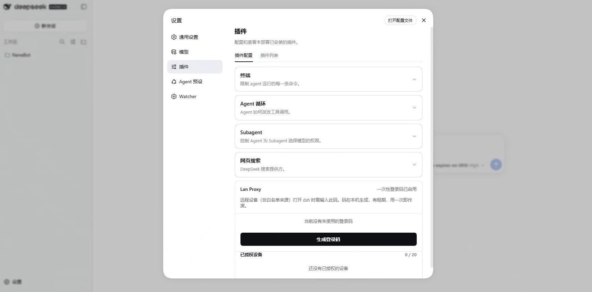

# dsh-lan-proxy

dsh 局域网/公网反向代理插件，运行在 dsh 进程内：对外监听 HTTP/HTTPS，转发到 dsh 回环服务。

dsh 禁止 `--host 0.0.0.0`；本插件即在 dsh 进程内套一层代理。纯 ESM、零构建、卸载自动清理（`ctx.effect()`）。

> 兼容 dsh 0.2.2（`web` profile）。dsh 尚未 1.0、有破坏性变更，请按版本锁定 `#v1.3.0`。



## 安装

```sh
# 本地目录（用 file:，勿用 link:——link: 不装 bundle 依赖）
dsh plugin --profile web add file:/path/to/dsh-lan-proxy
# 或 GitHub
dsh plugin --profile web add github:mariGoIds/dsh-lan-proxy#v1.3.0
# 装完重启 dsh
```

默认仅服务本机；按「配置」开放局域网/公网。

## 功能

**访问入口**

- 双栈监听 `::`（IPv4 + IPv6）：公网 IPv6 直连，免 NAT 配置
- IP 白名单（前缀/精确）：可信网段免密直进
- TLS `:3443`：证书缺失或端口占用只跳过对应监听，不杀 dsh

**登录码**

- 一次性登录码：本机手动生成、有租期、**用一次即作废**
- 生成入口：「设置 → 通用 → 远程登录码」这一行（点「展开」显示码与按钮）
- **只有部署 dsh 的那一端能生成 / 作废 / 管理设备**：经反代进来的已授权设备打开设置页只能看到「有没有码、还剩多久」，拿不到码本身，也发不了新码
- 登录码只在已登录的本机会话里可见，不在任何公网页面上暴露
- 失败限流：按 IP + 全局双重计数，全局超限后指数退避锁定

**已授权设备**

- 每台设备一个独立令牌，可在设置页**单独撤销**
- 设备列表显示：设备标签 · IP · 授权时间 · 最近使用
- 设备表只存令牌的 sha256，明文令牌只在浏览器 cookie 里
- 令牌有服务端有效期，到期自动失效

**与 dsh 的适配**

- 客户端 bundle 补丁：让 dsh 把经反代访问的页面视作本机，否则设置页只写内存、刷新即丢
- 自动登录 dsh 网页 token：token 不进浏览器地址栏、历史、截图或访问日志

**日志**

- 每请求一行，403 也记，可落盘
- URL 里的 `token` 等敏感参数自动脱敏

## 配置

Schemastery schema；安全默认（白名单/登录码/日志全空）。在 profile 的 `cordis.patch.yml` 覆盖：

```yaml
- id: lan-proxy
  config:
    listenHost: '::'
    httpListenHost: '127.0.0.1'
    listenPort: 3080
    tlsPort: 3443
    backendHost: 127.0.0.1
    backendPort: 3081
    allowedPrefixes: ['192.0.2.']   # 免密可信网段
    allowedIps: [198.51.100.25]
    cookieName: dsh_auth
    accessLog: true
    accessLogFile: ''               # '' = 仅进 dsh 日志器；非空则落盘
    certDir: ''                     # '' = $DSH_HOME/certs 或 ~/.dsh/certs
    forwardUntrusted: false         # true = 非白名单放行给 dsh
    patchClientBundle: true
    autoLogin: 'trusted'            # 'off' | 'trusted' | 'always'
    codeLogin: false
    codeLength: 6
    codeLeaseMinutes: 5
    codeMaxFails: 5
    codeGlobalMaxFails: 20
    codeLockMinutes: 10
    codeSessionDays: 30
    maxDevices: 20
    deviceStateFile: ''             # '' = $DSH_HOME/lan-proxy-devices.json
```

| 字段 | 默认 | 说明 |
|---|---|---|
| `listenHost` | `::` | HTTPS/双栈绑定地址；`::` = v4+v6 |
| `httpListenHost` | `127.0.0.1` | HTTP 明文口绑定地址；默认只绑回环 |
| `listenPort` / `tlsPort` | `3080` / `3443` | HTTP / HTTPS 端口 |
| `backendHost` / `backendPort` | `127.0.0.1` / `3081` | dsh 后端地址 |
| `allowedPrefixes` | `[]` | 免密网段前缀（v4/v6 通用） |
| `allowedIps` | `[]` | 免密精确 IP |
| `cookieName` | `dsh_auth` | 设备会话 cookie 名 |
| `accessLog` / `accessLogFile` | `false` / `''` | 每请求记日志，可落盘 |
| `certDir` | `''` | TLS 证书目录；文件为 `key.pem` + `cert.pem` |
| `forwardUntrusted` | `false` | 非白名单来源：`false` → 403；`true` → 放行给 dsh |
| `patchClientBundle` | `true` | 转发 `/plugins/` bundle 时改写客户端 `isLoopback` 判定 |
| `autoLogin` | `'trusted'` | 自动代取 dsh 网页 token：`'off'` / `'trusted'`（仅白名单）/ `'always'` |
| `codeLogin` | `false` | 开启一次性登录码 |
| `codeLength` | `6` | 登录码长度（纯数字），单次命中率 `1/10^codeLength` |
| `codeLeaseMinutes` | `5` | 登录码租期（分钟），逾期作废 |
| `codeMaxFails` | `5` | **单 IP** 在锁定窗口内允许的失败次数 |
| `codeGlobalMaxFails` | `20` | **全部来源合计**允许的失败次数 |
| `codeLockMinutes` | `10` | 锁定窗口（全局锁按触发次数指数退避，上限 24 小时） |
| `codeSessionDays` | `30` | 设备令牌与 cookie 的有效期 |
| `maxDevices` | `20` | 已授权设备上限，超出挤掉最久未使用的 |
| `deviceStateFile` | `''` | 设备表路径；`''` = `$DSH_HOME/lan-proxy-devices.json` |

## 访问判定

① 白名单 IP（本机 / `allowedIps` / `allowedPrefixes`）→ 直接放行。

② 非白名单 + 开启 `codeLogin` → 校验设备会话 cookie，无有效 cookie 则给登录页。

③ 非白名单 + 未开 `codeLogin` → 看 `forwardUntrusted`：`false` 返回 403，`true` 放行给 dsh。

## 一次性登录码

手机等非白名单设备打开 dsh 时，输入本机生成的登录码即可进入。

**生成 / 查看**：

- dsh 界面：「设置 → 通用 → 远程登录码」，收起时只显示状态与当前码，点「展开」后是码 + 倒计时 + 「生成登录码 / 重新生成 / 立即作废」按钮和已授权设备管理

**只有部署端能发码**：非白名单来源（经反代进来的已授权设备）在设置页里只能看到码是否存在与剩余时间，看不到码本身，也没有生成 / 作废 / 管理设备的按钮。判定依据是代理给非白名单请求加的 `x-lan-proxy-remote` 头——浏览器同源页面改不了它（非简单请求要过 CORS 预检，dsh 不回应），所以远程设备伪造不了。

```yaml
- id: lan-proxy
  config:
    codeLogin: true
    codeLength: 6            # 纯数字，1/10^codeLength 单次命中率
    codeLeaseMinutes: 5      # 租期，逾期作废
    autoLogin: 'always'      # 过了码这道门后，dsh token 由代理代取
```

**限流**：码是纯数字且租期内有效，必须配合失败限流。限流分两层 —— `codeMaxFails` 按 IP 计数，`codeGlobalMaxFails` 按**全部来源合计**计数。只有单 IP 那层时，攻击者轮换代理即可把额度成倍放大。

达到全局上限后全局上锁，且反复触发会让锁指数变长（10min→20min→40min…上限 24 小时），长时间安静后级别自动归零。

> 全局限流代价：攻击者可借此把合法远程用户挡在门外。故 `codeGlobalMaxFails` 不要调得过低。

## 已授权设备

每台通过登录码授权的设备各持一个独立令牌，可单独撤销。

- 设置页卡片列出全部已授权设备，每行一个「撤销」按钮，底部有「全部撤销」
- 设备上限 `maxDevices`，超出时挤掉最久未使用的
- 设备表落盘只存令牌的 sha256（`$DSH_HOME/lan-proxy-devices.json`），明文令牌只存在于浏览器 cookie
- 令牌有服务端有效期 `codeSessionDays`，到期即失效
- 重启不掉线：校验走哈希比对，设备表持久化

## 客户端 bundle 补丁（`patchClientBundle`）

dsh 0.1.2+ 在客户端按页面主机名判定「本页是否本机」：

```js
isLoopback: transport?.ownsHost === true || pageLocation === void 0
            || isLoopbackHostname(pageLocation.hostname)
```

该值只被设置页消费（`persistence = isLoopback ? 'host' : 'memory'`）。经反代访问主机名必然不是 `127/8`，于是设置只写内存、刷新即丢。

插件在转发时把该判定替换为 `true`。实现要点：

- **不改磁盘文件**，每次请求实时改写 ⇒ dsh 升级后无需重打补丁
- 定位方式：dsh 把 bundle 合并成一次请求下发（`/plugins/??a/client.js,b/client.js&rev=<内容哈希>`），按查询串是否含 `dsh-client-connection/client.js` 判定
- **保留 gzip**（解压→替换→回压）：该 bundle 未压缩约 11.5MB、gzip 后约 4.0MB
- **保留上游 `cache-control`**，只在正文变化时去掉 `ETag`
- 任一环节出错都退回原包；锚点失配时静默透传

## 自动登录 dsh token（`autoLogin`）

dsh 0.1.2+ 的首页要求先经 `/?token=<进程token>` 换取 cookie，否则一律 401。该 token 由 dsh 启动时随机生成、只存在内存。

`autoLogin` 开启后由代理代为完成这次交换，token 不进浏览器地址栏、历史、截图或访问日志。

| 取值 | 行为 |
|---|---|
| `'off'` | 不干预，访客面对 dsh 的 401 |
| `'trusted'`（默认） | 仅对白名单/本机来源自动登录 |
| `'always'` | 对通过访问门的任何来源自动登录 |

> ⚠️ `'always'` 会让 dsh 的 token 门对来访者完全透明。此时必须有另一道闸门（IP 白名单或 `codeLogin`），否则等价于无认证——任何人都能驱动 agent 执行命令。

## 访问日志

`accessLog: true` 时每请求一行，403 也记：

```
2026-08-17T04:00:00.000Z https ip=2001:db8::99 "GET /" 200 12ms 48213b
```

URL 里的敏感查询参数会自动脱敏（`token` / `access_token` / `auth`）：

```
2026-08-17T04:00:00.000Z https ip=2001:db8::99 "GET /?token=<redacted>" 303 3ms 0b
```

## 已知限制

- **白名单是免密通道**：别放不可信网段（如移动宽带）
- **登录码只在本机可见**。人在外网看不到本机屏幕时，改用白名单（如虚拟局域网）
- **访问日志无轮转**：`accessLogFile` 只增不减，需自行清理
- **全局限流可被用于 DoS**：攻击者故意输错可把合法远程用户挡在门外
- **bundle 补丁依赖 dsh 内部写法**：锚点失配时静默透传（功能降级、不报错），dsh 大版本升级后建议复查设置页是否仍能保存
- 设备标签由 UA 粗略推断（仅作展示，不参与任何判定）

## 证书与公网 IPv6

`::` 默认已监听 v6，公网访问 `https://<IPv6>:3443`。**证书 SAN 必须含该 IPv6**（或域名），否则浏览器报名称不匹配；SLAAC 地址会变，优先 DNS/DDNS。无 IPv6 时用 `listenHost: '0.0.0.0'` + 路由器端口转发。

生成证书（文件固定 `certDir/key.pem`、`certDir/cert.pem`）：

```sh
openssl req -x509 -newkey rsa:2048 -nodes -keyout key.pem -out cert.pem -days 3650 \
  -subj "/CN=DeepSeek-Harness-LAN" \
  -addext "subjectAltName=DNS:example.com,IP:192.0.2.10,IP:127.0.0.1,DNS:localhost"
```

证书缺失只禁用 HTTPS，HTTP 照常（记 warning）。

## 开发

```sh
npm test   # node:test，fake request 驱动，无需运行 dsh
```

## License

MIT
